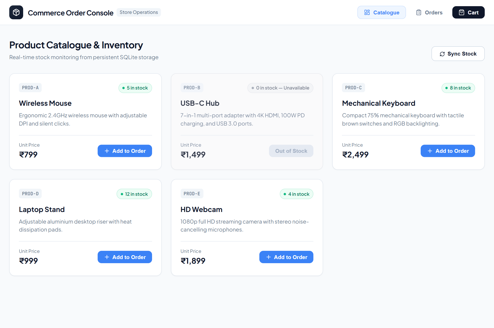
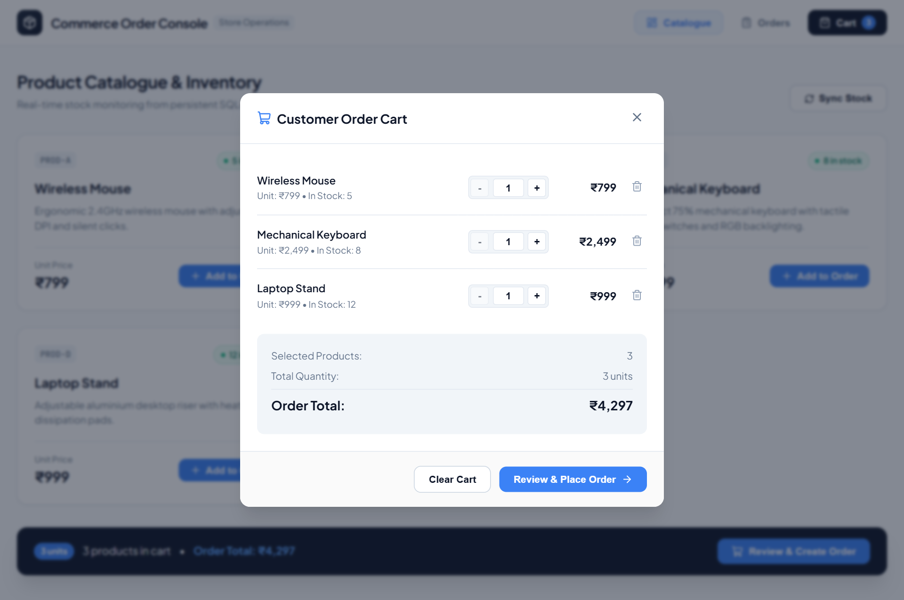
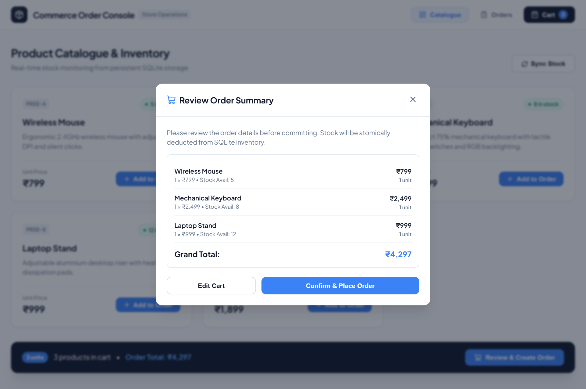
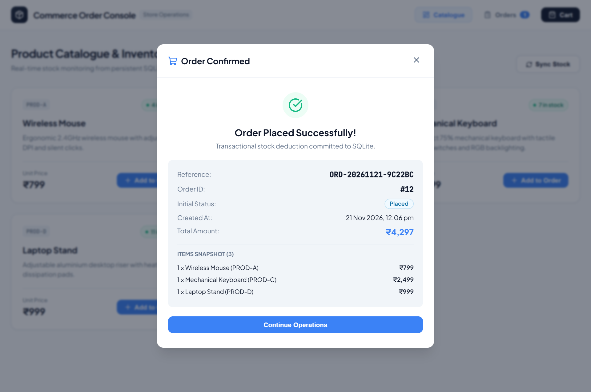
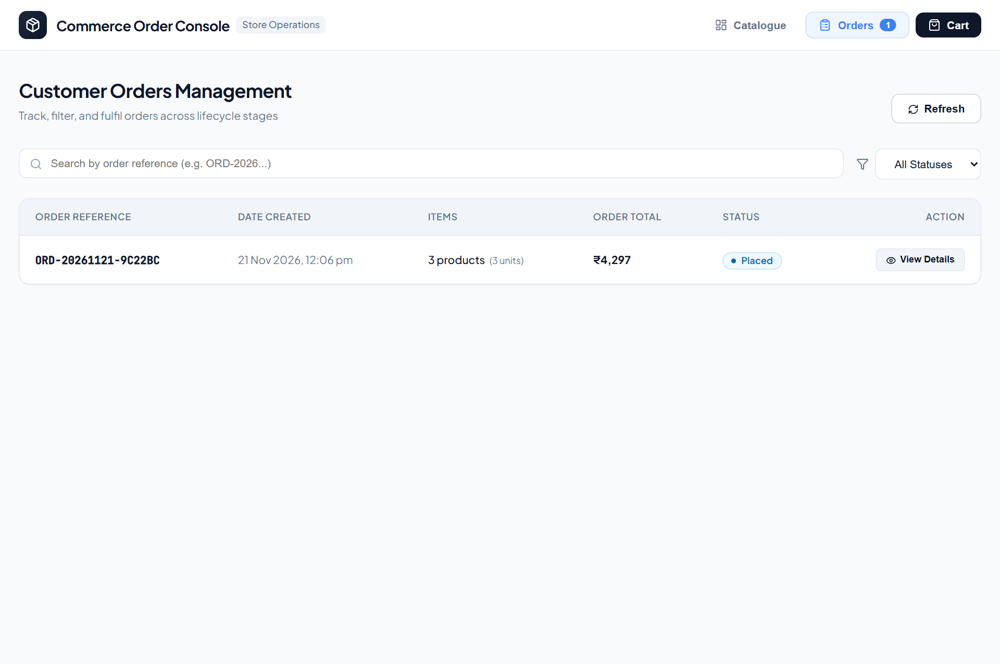
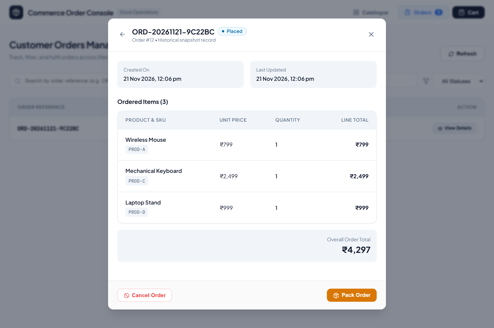
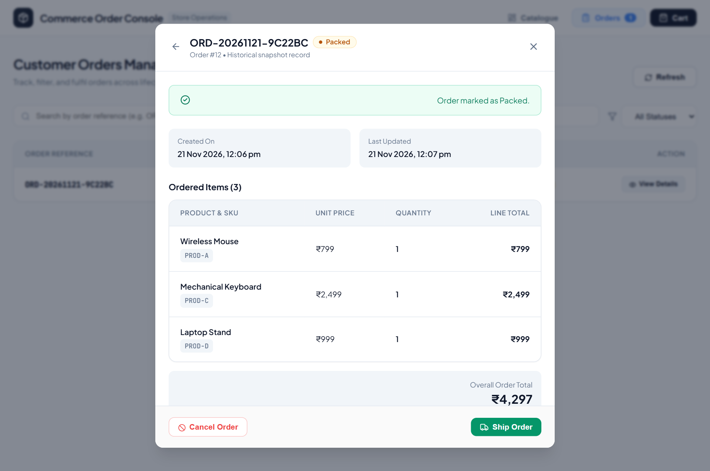
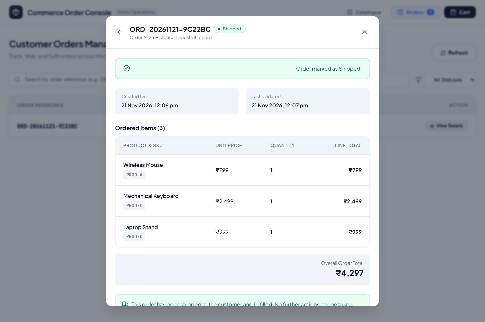
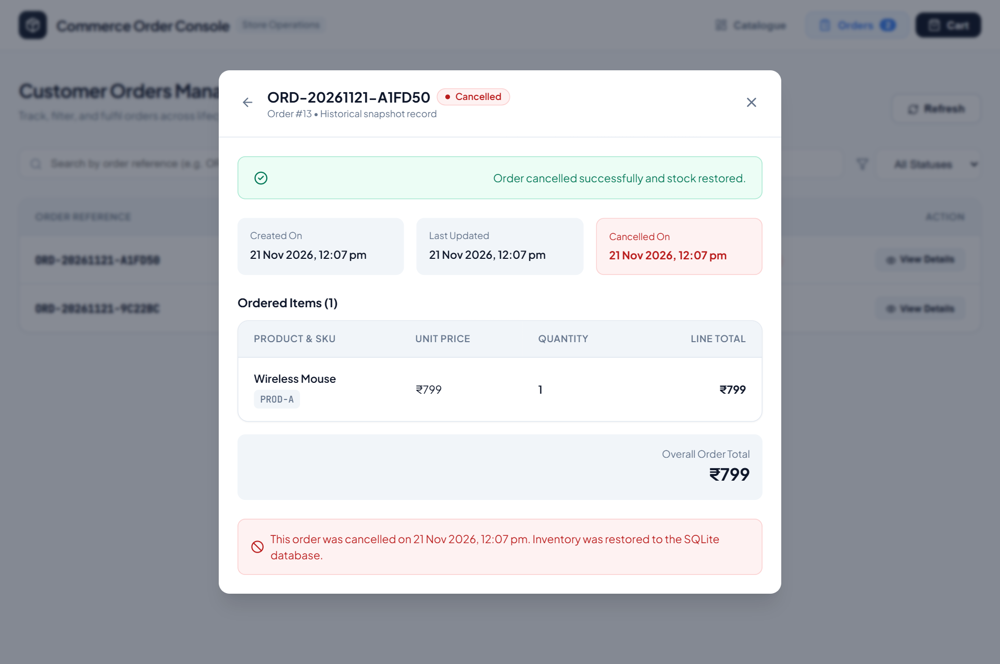
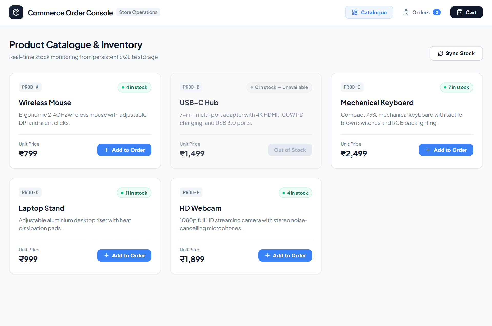

# Commerce Order Console — Visual Walkthrough

This document demonstrates the full lifecycle of the Commerce Order Console using actual screenshots captured from the live application running in Google Chrome.

---

## 1. Product Catalogue & Real-Time Stock Monitoring

The console initializes with 5 synthetic products loaded directly from the persistent SQLite database (`data/commerce.db`).
- **Product A (Wireless Mouse):** 5 in stock (₹799)
- **Product B (USB-C Hub):** 0 in stock — marked as unavailable with disabled "Out of Stock" button (₹1,499)
- **Product C (Mechanical Keyboard):** 8 in stock (₹2,499)
- **Product D (Laptop Stand):** 12 in stock (₹999)
- **Product E (HD Webcam):** 4 in stock (₹1,899)

Notice the clear stock status badges (`X in stock` in green vs `0 in stock — Unavailable` in gray with disabled buttons).

---

## 2. Multi-Product Cart & Quantity Validation

Store staff can select multiple different products to compose an order.
- The cart dynamically calculates unit prices, quantities, line totals, and overall grand total in Indian Rupees (₹).
- Quantity controls prevent invalid values (< 1, zero, negative, or floats) and cap adjustments at the maximum available stock.
- Individual products can be removed or quantities changed on the fly.

---

## 3. Order Review & Confirmation Summary

Before final submission, staff are presented with an order confirmation summary detailing line items, quantities, available stock, and grand total. Staff can review the items or click "Edit Cart" to make adjustments.

---

## 4. Atomic Order Placement & Transaction Receipt

Upon clicking "Confirm & Place Order", the backend initiates an atomic `BEGIN IMMEDIATE TRANSACTION` in SQLite.
- Authoritative database stock is verified.
- Inventory is deducted for each product.
- An order record is created with initial status `Placed`.
- Historical snapshot records are inserted into `order_items`.
- The user is presented with a success receipt showing the generated order reference (e.g. `ORD-20261121-7A3F`), total amount, and snapshot details.

---

## 5. Orders Management, Search & Filter Bar

The Orders section displays customer orders in a clean, high-density table.
- **Columns:** Order Reference, Date Created, Number of Items/Units, Order Total, Current Status Pill, and "View Details" action.
- **Filters:** Real-time reference search input (e.g. `ORD-2026`) debounced at 250ms combined with status dropdown (`All`, `Placed`, `Packed`, `Shipped`, `Cancelled`).

---

## 6. Order Detail View & Historical Snapshots

Clicking "View Details" loads the complete order breakdown using the preserved snapshot data:
- For an order in `Placed` status, the console presents the **Pack Order** and **Cancel Order** actions.
- Product name, SKU, unit price, quantity, and line total are displayed from immutable snapshot records.

---

## 7. Fulfilment Progression: Packing the Order

Clicking **Pack Order** prompts staff for confirmation and sends `PATCH /api/orders/:id/status` with `{ "status": "Packed" }`.
- State transitions from `Placed` → `Packed`.
- The UI dynamically updates the available actions to **Ship Order** and **Cancel Order**.

---

## 8. Final Fulfilment: Shipping the Order

Clicking **Ship Order** completes the fulfilment workflow:
- State transitions from `Packed` → `Shipped`.
- Because shipped orders are finalized, further status changes or cancellations are disabled both on the frontend and on the server.
- The UI displays a persistent fulfilled notice.

---

## 9. Order Cancellation & Exactly-Once Stock Restoration

Cancelling an eligible (`Placed` or `Packed`) order executes a single database transaction that:
1. Re-verifies current status is eligible.
2. Restores each ordered item's quantity back to `products.stock_quantity`.
3. Sets status to `Cancelled` and records the `cancelled_at` timestamp.
4. Prevents duplicate cancellations or stock restoration.

---

## 10. Live Inventory Synchronization & Restored Stock

Returning to the Product Catalogue demonstrates that cancelled order stock is restored immediately in the SQLite inventory.
- Inventory counts accurately reflect the returned items.
- The entire process is grounded in the backend database as the single source of truth.

